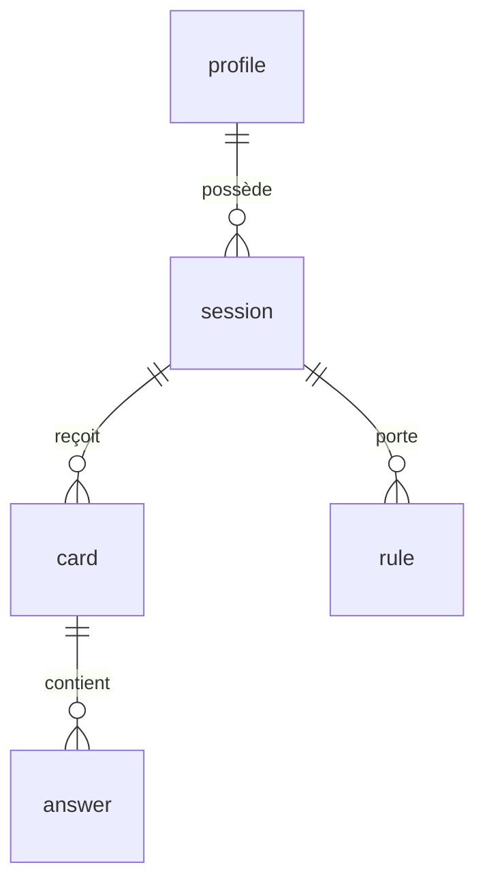

# 05 — Schéma back-end · Base de données & sécurité

Base **Supabase (Postgres)**, nouveau projet, région UE. Le **catalogue des 12 questions est figé dans le code** (constante `CATALOGUE`), pas en base : les réponses stockent les identifiants section/question/option.

## 1. Tables

### `profile` (le manager)
| Colonne | Type | Notes |
|---|---|---|
| id | uuid (PK) | = `auth.uid()` |
| email | text | |
| display_name | text | nom affiché (optionnel) |
| created_at | timestamptz | défaut `now()` |

### `session`
| Colonne | Type | Notes |
|---|---|---|
| id | uuid (PK) | |
| owner_id | uuid (FK → profile.id) | le manager |
| title | text | |
| share_token | text (unique) | sert au lien `/r/[token]` |
| created_at | timestamptz | |

### `card` (une carte remplie par un collaborateur)
| Colonne | Type | Notes |
|---|---|---|
| id | uuid (PK) | |
| session_id | uuid (FK → session.id) | |
| first_name | text | |
| last_name | text | |
| role_title | text | poste |
| email | text | pour l'envoi de la carte |
| created_at | timestamptz | |

### `answer`
| Colonne | Type | Notes |
|---|---|---|
| id | uuid (PK) | |
| card_id | uuid (FK → card.id, on delete cascade) | |
| section_id | text | ex. `comm` |
| question_id | text | ex. `q1` |
| option_index | int | 0, 1 ou 2 |

### `rule` (règle d'équipe)
| Colonne | Type | Notes |
|---|---|---|
| id | uuid (PK) | |
| session_id | uuid (FK → session.id) | |
| text | text | la règle |
| theme | text | section d'origine (optionnel) |
| position | int | ordre d'affichage |
| created_at | timestamptz | |

## 2. Relations

## 3. Sécurité (RLS) — principe
RLS activée sur toutes les tables.
- **profile** : chacun lit/modifie uniquement sa propre ligne (`id = auth.uid()`).
- **session** : le manager accède à ses sessions (`owner_id = auth.uid()`) en lecture/écriture.
- **card** / **answer** : **lecture réservée au manager** propriétaire de la session (jointure `session.owner_id = auth.uid()`). **Aucune écriture directe** : l'insertion se fait par la fonction token ci-dessous.
- **rule** : lecture/écriture par le manager propriétaire de la session.

## 4. Fonctions SQL (`security definer`)

### `public_session(p_token text)` → (id, title)
Résout un lien de partage sans exposer la table : renvoie l'id et le titre de la session correspondant au token (pour afficher le formulaire). Rien d'autre.

### `submit_card_by_token(p_token, p_first_name, p_last_name, p_role, p_email, p_answers jsonb)` → uuid
Valide le token, crée la `card` (avec nom/prénom/poste/email), insère les `answer` (liste `{section_id, question_id, option_index}`), renvoie l'id de la carte. Seule voie d'écriture pour le collaborateur.

## 5. Migrations (ordre)
1. `0001_schema.sql` — tables ci-dessus + RLS activée (deny-all par défaut).
2. `0002_policies.sql` — policies manager (session/card/answer/rule).
3. `0003_functions.sql` — `public_session` + `submit_card_by_token`.

À lancer dans Supabase → SQL Editor, dans l'ordre, une par une.

## 6. Note
Pas de table `organization`/`team`/`catalogue` dans le MVP : un manager possède directement ses sessions, et le catalogue vit dans le code. On pourra enrichir plus tard sans casser ces tables.
